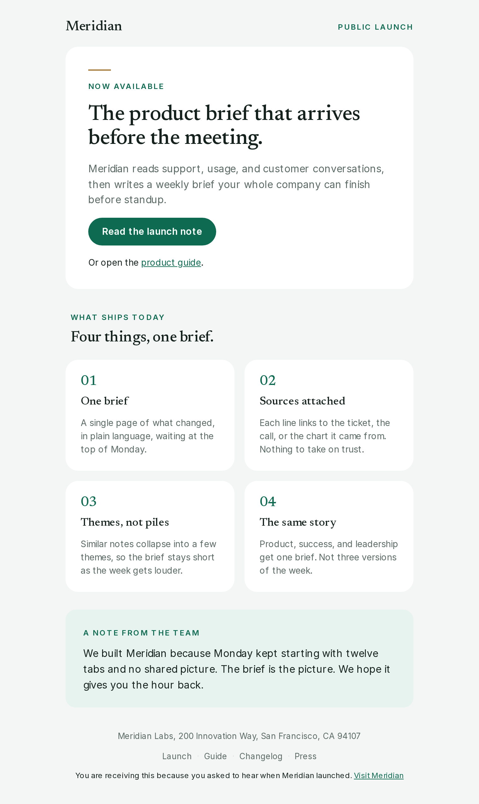
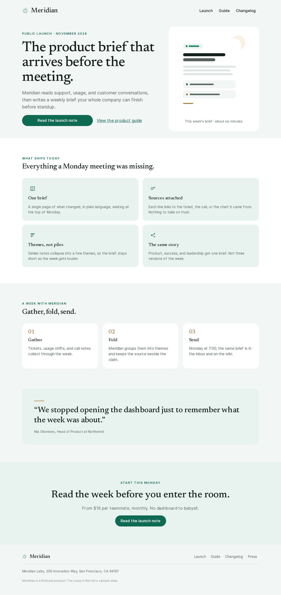
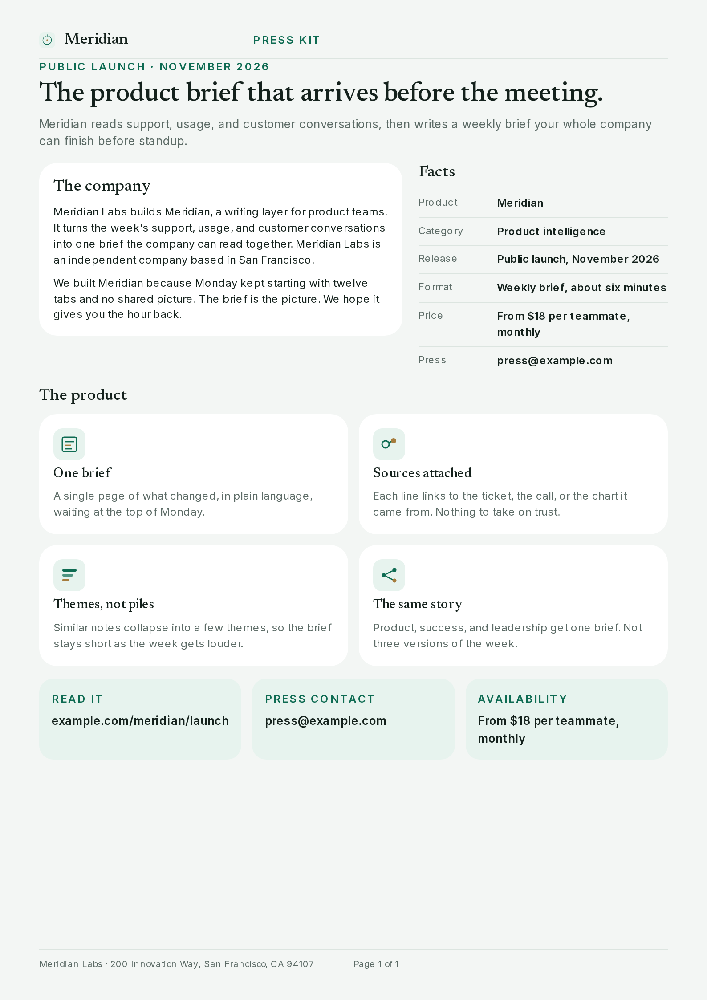
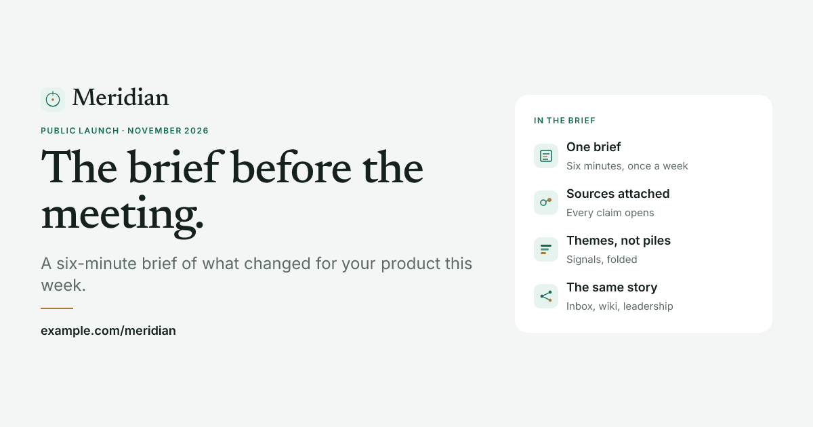
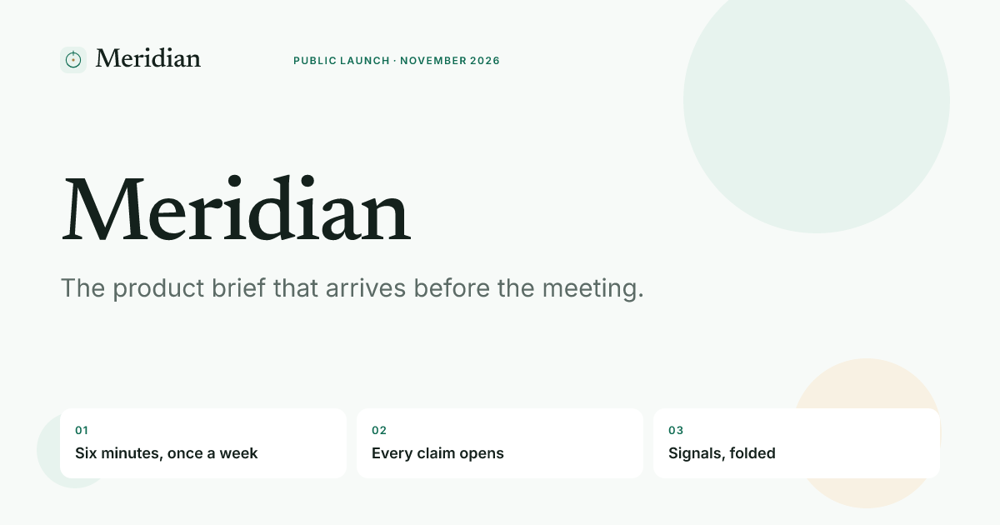
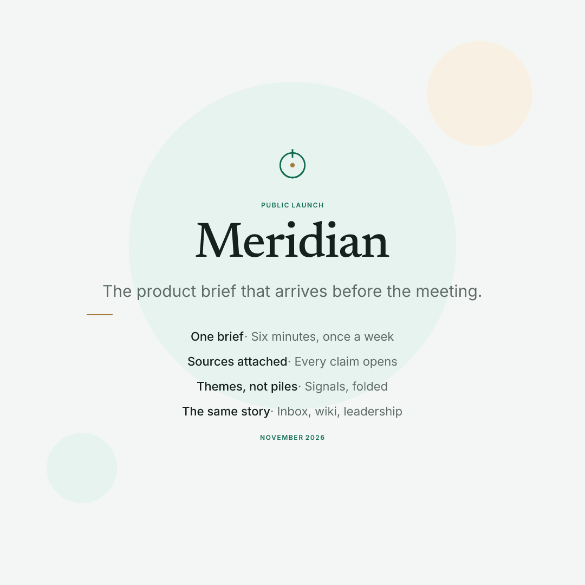

# Lumen

A clean product launch kit for a fictional SaaS. One data object renders a launch email, an announcement page, a one-page press kit PDF, and three social images.

The sample product is **Meridian**, a weekly brief for product teams. Change the record in [`src/data/product.ts`](src/data/product.ts) and every surface updates together.

## How Hyper Elements is used

Everything visual is written with [Hyper Elements](https://github.com/hyper-elements/hyper-elements) (`@hyper-elements/react`). There is no React Email, MJML, hand-built email table, or direct use of react-pdf or Satori.

- One theme, [`src/theme/theme.ts`](src/theme/theme.ts), from `defineTheme()`. It sets color, type, button, link, and named styles (`card`, `wash`, `eyebrow`). Email and print override only the heading sizes, through `formats`.
- Shared pieces in [`src/components/`](src/components/) (`Lockup`, `FeatureGrid`, `Mark`, `FeatureIcon`, `BriefArt`) are used by more than one root.
- The root decides the output:
  - [`src/templates/launch-email.tsx`](src/templates/launch-email.tsx) — `<Email>`, email-client HTML and plain text via `render()`
  - [`src/templates/announcement-page.tsx`](src/templates/announcement-page.tsx) — `<Page>`, responsive HTML via `render()`
  - [`src/templates/press-kit.tsx`](src/templates/press-kit.tsx) — `<Document>`, print HTML via `render()` and a PDF via `renderPdf()` from `@hyper-elements/react/pdf`
  - [`src/templates/social-x.tsx`](src/templates/social-x.tsx), [`social-og.tsx`](src/templates/social-og.tsx), [`social-instagram.tsx`](src/templates/social-instagram.tsx) — `<Canvas>`, PNG via `renderImage()` from `@hyper-elements/react/image`
- `<Svg>` draws the mark, the feature icons, the brief illustration, and the poster fields. Svg is not email-safe (Gmail and classic Outlook drop it, and `validate()` rejects it inside `<Email>`), so the email uses the same theme and the same feature copy with typographic numerals instead of icons.
- Styles live in `style={{ }}`. Space between blocks is the parent's `gap`. There are no margins and no raw HTML.
- `npm run check` runs `validate()` on every design (the email also gets `@hyper-elements/email-clients`) and prints `outline()` so the layout can be read without opening the HTML. Errors and warnings fail the script. Remaining email notes are client degradation Hyper Elements reports on purpose: most clients skip web fonts and fall back to Georgia or Arial, and classic Outlook squares off corners and draws medium weights as regular.
- `@react-pdf/renderer`, `satori`, and `@resvg/resvg-js` are installed only because the Hyper Elements PDF and image entry points peer-depend on them. This repo never imports those libraries.

Links in the sample point at `example.com` so the kit does not send anyone to a real product site.

## Outputs

### 1. Launch email



`dist/launch-email.html` and `dist/launch-email.txt`

### 2. Announcement page



`dist/announcement.html`

### 3. Press kit (one A4 page)



`dist/press-kit.pdf` and `dist/press-kit.html`

### 4. Social images

X / Twitter, 1200×630



Open Graph, 1200×630



Instagram, 1080×1080



`dist/social-x.png`, `dist/social-og.png`, `dist/social-instagram.png`

## Run it

Node 20 or newer.

```bash
npm install
npm run check
npm run render
```

| Script | What it does |
| --- | --- |
| `npm run check` | `validate()` and `outline()` for all six designs. Exits 1 on any error or warning. |
| `npm run render` | The same checks, then writes `dist/`. |
| `npm run typecheck` | `tsc --noEmit`. |

`npm run render` writes:

```text
dist/launch-email.html
dist/launch-email.txt
dist/announcement.html
dist/announcement.txt
dist/press-kit.html
dist/press-kit.pdf
dist/social-x.png          1200×630
dist/social-og.png          1200×630
dist/social-instagram.png   1080×1080
```

The press kit render checks that the PDF is a single page. Image render uses `strict: true`, so a missing font weight or text past the canvas fails the script.

Open the HTML files in a browser. The PDF is `dist/press-kit.pdf`.

## Change the sample

Edit [`src/data/product.ts`](src/data/product.ts). Name, tagline, description, features, steps, quote, price, links, and the press facts are all in that one object. The templates do not hard-code the product story.

Then:

```bash
npm run render
```

To retune color or type, edit [`src/theme/theme.ts`](src/theme/theme.ts). Font files for PDF and PNG live in [`fonts/`](fonts/) (Inter and Newsreader, SIL OFL). If you add a weight, add the file and list it in [`src/theme/fonts.ts`](src/theme/fonts.ts).

## Layout

```text
src/data/product.ts          the fictional SaaS
src/theme/theme.ts           the light theme
src/theme/fonts.ts           web font faces and local files
src/components/              lockup, features, Svg illustrations
src/templates/               Email, Page, Document, three Canvases
scripts/render-all.tsx       validate, outline, render
dist/                        generated output
previews/                    screenshots used in this readme
```
